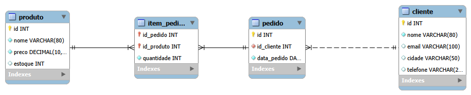

# Projeto SQL: Banco de Dados de uma Loja

Projeto de estudo em **SQL (MySQL 8)**. Modelei um banco de dados simples de loja,
populei com dados fictícios e respondi **11 perguntas de negócio** usando consultas SQL.

Feito durante minha graduação em Análise e Desenvolvimento de Sistemas, como parte
da minha trilha de estudos em **Análise de Dados**.

## Modelo do banco (DER)



| Tabela | O que guarda |
|---|---|
| `cliente` | Nome, e-mail, cidade e telefone de cada cliente |
| `produto` | Nome, preço e estoque de cada produto |
| `pedido` | Qual cliente fez o pedido e em que data |
| `item_pedido` | Quais produtos e quantidades fazem parte de cada pedido |

Relacionamentos: um cliente faz vários pedidos (1:N) e um pedido tem vários produtos
e vice-versa (N:N, resolvido pela tabela `item_pedido`).

## Perguntas respondidas

| # | Pergunta de negócio | Conceitos SQL |
|---|---|---|
| 1 | Quais produtos custam mais de R$ 100? | `WHERE`, `ORDER BY` |
| 2 | Quais clientes têm nome começando com "A" ou moram em São Paulo? | `LIKE`, `OR` |
| 3 | Quais produtos custam entre R$ 50 e R$ 200? | `BETWEEN` |
| 4 | Em quais cidades há clientes? | `DISTINCT` |
| 5 | Quais são os 3 produtos mais caros? | `ORDER BY`, `LIMIT` |
| 6 | Quantos clientes existem? | `COUNT` |
| 7 | Qual o total em estoque e o preço médio dos produtos? | `SUM`, `AVG`, `ROUND` |
| 8 | Quantos clientes há em cada cidade? | `GROUP BY` |
| 9 | Quais cidades têm 2 ou mais clientes? | `HAVING` |
| 10 | Quem fez cada pedido? | `JOIN` |
| 11 | Qual o valor total de cada pedido? | `JOIN` (4 tabelas), `SUM`, `GROUP BY` |

### Exemplo: valor total de cada pedido (pergunta 11)

```sql
SELECT pedido.id, cliente.nome,
       SUM(item_pedido.quantidade * produto.preco) AS total
FROM pedido
JOIN cliente ON pedido.id_cliente = cliente.id
JOIN item_pedido ON item_pedido.id_pedido = pedido.id
JOIN produto ON item_pedido.id_produto = produto.id
GROUP BY pedido.id, cliente.nome
ORDER BY pedido.id;
```

| id | nome | total |
|---|---|---|
| 1 | Ana Souza | 239.70 |
| 2 | Bruno Lima | 899.00 |
| 3 | Ana Souza | 289.60 |
| 4 | Carla Dias | 304.80 |
| 5 | Diego Rocha | 1798.00 |
| 6 | Ana Souza | 129.90 |
| 7 | Carla Dias | 259.30 |

## Como rodar

1. Instale o **MySQL Server** e o **MySQL Workbench**.
2. Abra o Workbench, conecte-se ao servidor e execute o arquivo `criar_banco.sql`
   (cria o banco `loja`, as tabelas e os dados).
3. Abra o arquivo `loja_mysql.sql` e execute as consultas uma a uma
   (`Ctrl + Enter` roda a consulta em que o cursor está).

## Arquivos

- `criar_banco.sql`: cria o banco, as tabelas e insere os dados
- `loja_mysql.sql`: as 11 consultas, com comentários
- `der_loja.png`: diagrama do banco

## Tecnologias

MySQL 8 · MySQL Workbench

## Próximos passos

- Criar uma *view* com o total por pedido
- Analisar os dados com **Python (pandas)** e montar gráficos
- Construir um dashboard no Power BI
